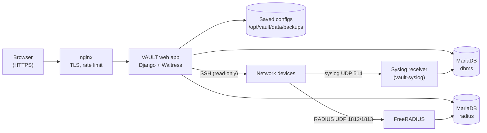

<div align="center">

# BdREN VAULT

**Network configuration backup and RADIUS / AAA access control, in one web portal.**


-blue)

[Features](#features) ·
[Installation](#installation) ·
[Updating](#updating) ·
[Security](#security) ·
[Operations](#operations) ·
[Documentation](#documentation)

</div>

---

## Overview

BdREN VAULT gives a network team one place for two jobs that normally need separate tools:

| | |
|---|---|
| **Configuration backup** | Connects to switches, routers, firewalls and OLTs over SSH, saves the running configuration on a schedule or on demand, keeps every version and shows exactly what changed. |
| **RADIUS / AAA access control** | Decides who may log in to those devices, at which access level and on which devices. FreeRADIUS answers every device login against these rules. |

The web application **manages** the data; **FreeRADIUS** answers device logins on its own, so logins keep
working while the web application restarts or is updated.

> VAULT only **reads** device configuration. It never sends a command that changes a device.

Tested with **20,000+ devices** and **30,000+ RADIUS users / NAS clients** on generated data.

---

## Features

### Configuration backup
- Scheduled backups (selected days of the month, daily, every N days or every N minutes) and on-demand
  backups of one device, a selection or the whole inventory
- A new version is saved only when the configuration actually changed; every version is kept with a
  SHA-256 checksum
- Line-by-line comparison of any two versions, and **Change Reports** for a period (CSV / PDF)
- Patient SSH with an automatic retry queue for devices that were offline or slow
- Up to 200 parallel SSH sessions (`DBMS_MAX_WORKERS`, default 50)
- **Retention:** one setting keeps Activity Logs and saved configurations for Forever, 1, 3, 6, 12 or
  24 months. The newest configuration of every device is always kept.

**Supported platforms:** Cisco IOS / IOS-XE, NX-OS and ASA · Huawei VRP and SmartAX OLTs · Juniper Junos ·
MikroTik RouterOS · Fortinet FortiOS · Arista EOS · HPE Comware · TP-Link Omada / JetStream · BDCOM ·
V-SOL · any other device through generic SSH

### RADIUS / AAA
- Device login accounts with three access levels: **super-admin**, **read-write**, **read-only**, mapped
  per vendor (Cisco privilege, Huawei level, Juniper class, MikroTik group, Fortinet profile)
- Limit a user to specific devices or to a device type; new devices of that type are covered automatically
- New NAS devices work immediately, with no FreeRADIUS restart
- **Authentication Audit:** every login attempt, with the device it came from
- **Session Log:** every device login as a session (who, which device, from where, how long) and,
  per user, each session with every command and configuration change in order; read from the devices' own
  syslog (Huawei, Cisco, Juniper, MikroTik, Fortinet) and the RADIUS logins; search, filter and export to CSV
- A login with an unknown username blocks the source address for 2 days
- Copy-ready configuration commands per vendor on the **Device Setup** page

### Monitoring and operations
- Continuous ICMP reachability monitoring (fping for large inventories) with an uptime dashboard
- Backup Jobs page with live progress, Activity Logs and one audit trail of every administrative action (panel and RADIUS)
- Notification bell for failed backups and other problems
- Responsive interface for desktop, tablet and phone, with light and dark themes

---

## Architecture



| Layer | Technology |
|---|---|
| Language / framework | Python 3.10+, Django 5.2 LTS |
| Application server | Waitress, run by systemd (`vault.service`) |
| Syslog receiver | `manage.py syslog_receive`, run by systemd (`vault-syslog.service`) |
| Web server | nginx (HTTPS, login rate limit) |
| Database | MariaDB / MySQL: `dbms` for the application, `radius` for FreeRADIUS |
| AAA | FreeRADIUS 3 with the rlm_sql module |
| Device access | Netmiko / Paramiko over SSH |
| Encryption | `cryptography` (Fernet) for device passwords, SHA-256 for backup integrity |
| Front end | Django templates, plain JavaScript and CSS, no external CDN |

The code has eight apps (`accounts`, `devices`, `backups`, `scheduling`, `monitoring`, `radius`, `commandlog`,
`core`)
that follow strict layers, **models → selectors → services → views**, checked by
`python manage.py check_architecture`. See [docs/ARCHITECTURE.md](docs/ARCHITECTURE.md).

---

## Requirements

| | |
|---|---|
| Server | Ubuntu or Debian (64-bit), with internet access during installation |
| Network | The server reaches devices on **SSH (TCP 22)** and **ICMP**; devices reach the server on **UDP 1812 / 1813** for RADIUS and **UDP 514** for Session Log (syslog) |
| Browser | Any current browser; users reach the server on **TCP 443** |

Everything else (Python packages, MariaDB, FreeRADIUS, nginx, fping, fail2ban) is installed by the installer.

---

## Installation

### 1. Get the code

```bash
sudo apt update && sudo apt install -y git
git clone https://github.com/ahsanulhaqueromman/BdREN-VAULT.git
cd BdREN-VAULT
```

> If the repository is private, Git asks for a username and a **personal access token** (GitHub →
> Settings → Developer settings → Personal access tokens), not your GitHub password.

### 2. Run the installer

```bash
sudo bash deploy/install.sh
```

On a new server it asks a few questions once:

| Question | Notes |
|---|---|
| Address people will use | Public or private IP address, or a domain name; both kinds of address keep working |
| Database password | Press Enter to generate one |
| First administrator | Username and password (12 characters or more) |
| Install FreeRADIUS, HTTPS, firewall? | Each defaults to yes |

It then does the rest on its own:

1. System packages, a `vault` service user and the program in `/opt/vault`
2. Python virtual environment and dependencies
3. MariaDB with the `dbms` database, migrations and the first administrator
4. FreeRADIUS with its own `radius` database, the SQL module and VAULT's policies
5. RADIUS extras: device logging for logins, unknown-username IP blocking, instant new NAS devices and a
   firewall that opens UDP 1812/1813 only for NAS clients
6. nginx on HTTPS (self-signed certificate until a domain is set), the `vault` systemd service
7. Hardening: login rate limit, fail2ban, automatic security updates
8. A final health check

Passwords that the installer generates are stored only in `/opt/vault/.env`.

### 3. Open the portal

```
https://<server-address>/
```

Sign in with the administrator you created. The browser warns about the self-signed certificate until a
domain is configured (next step).

### 4. Optional: a domain name with a free certificate

```bash
sudo bash /opt/vault/deploy/set-domain.sh backup.example.com you@example.com
```

Needs a DNS A record pointing at the server and ports 80 / 443 reachable. A Let's Encrypt certificate is
issued and renewed automatically; the IP address keeps working.

### 5. Prepare the devices

- Create a backup account on each device that can **view the full configuration but not change it**.
  A plain read-only level often returns only part of the configuration; see the per-vendor commands in
  [docs/DEPLOY.md](docs/DEPLOY.md#backup-account-on-the-devices).
- Add the devices under **Device Inventory** (one IP, several IPs separated by commas, or an imported IP list).
- For RADIUS, add each device under **NAS Clients** and apply the commands from **Device Setup**.
- **Keep one local administrator account on every device**, so you are never locked out if RADIUS is
  unreachable.

---

## Updating

```bash
cd BdREN-VAULT
git pull
sudo bash deploy/install.sh
```

An update keeps `.env`, `data/` (saved configurations and keys) and both databases. It replaces the program
files, migrates the database and restarts the service. The previous version is saved in
`/var/backups/vault/` and restored automatically if the update fails. Afterwards, reload the portal once
with **Ctrl+F5**.

Release notes for every build are in [CHANGES.md](CHANGES.md).

---

## Configuration

Settings live in `/opt/vault/.env`; [.env.example](.env.example) documents every option. The most common:

| Setting | Default | Purpose |
|---|---|---|
| `DJANGO_ALLOWED_HOSTS` | set by installer | Addresses and domains the portal answers on |
| `DBMS_DB_*` | set by installer | Application database connection |
| `RADIUS_DB_*` | set by installer | FreeRADIUS database connection |
| `DBMS_MAX_WORKERS` | `50` | Maximum parallel SSH sessions (up to 200) |
| `DBMS_SESSION_MINUTES` | `15` | Idle sign-out time |
| `DBMS_PING_SECONDS` | `300` in `.env.example` | Reachability monitor interval in seconds (`0` turns it off) |
| `SYSLOG_PORT` | `514` | UDP port of the Session Log syslog receiver (run `deploy/enable_syslog.sh` after a change) |

Backup schedule, parallel sessions and retention are changed in the portal under **System Settings**.
After editing `.env`, run `sudo systemctl restart vault`.

---

## Roles

| Role | Can do |
|---|---|
| **Viewer** | See everything except administration pages |
| **Operator** | Viewer rights, plus add and edit devices and run backups |
| **Administrator** | Everything, including deleting, RADIUS / AAA, users and settings |

---

## Security

**Portal**
- HTTPS with HSTS, secure cookies, a strict Content Security Policy, no-sniff and clickjacking protection
- Passwords hashed by Django, minimum 12 characters
- 5 wrong passwords lock that address and username for 5 minutes; nginx rate-limits the login page;
  fail2ban bans addresses that keep failing
- Idle sign-out after 15 minutes (configurable)
- Role-based access; RADIUS / AAA and user management are for administrators only
- CSRF protection on every form; every sign-in and change is recorded with time, user and IP

**Device credentials and backups**
- Device SSH passwords are encrypted with Fernet; the key (`data/secret.key`) never leaves the server and
  is never in Git
- Saved passwords and RADIUS shared secrets are hidden until **Show** is pressed, and revealing one is logged
- Every saved configuration has a SHA-256 checksum

**RADIUS**
- UDP 1812 / 1813 is open only to devices on the NAS Clients list; the firewall is updated by a root-owned
  script that takes no arguments, so the website cannot choose a firewall rule
- Logins with unknown usernames block the source address for 2 days
- Every device login is recorded in Authentication Audit

**Session Log (syslog)**
- The receiver runs as the unprivileged `vault` user; systemd gives it only the right to use port 514
- UDP 514 is open in the firewall only for NAS Clients, and the receiver also drops every message from any
  other address, so nobody else can write into the history
- Each device may send at most 200 messages a second; the rest are dropped and counted
- Kept for the same time as the other logs (**System Settings > Keep logs and backup files for**)

**Server**
- Runs as an unprivileged `vault` user; automatic security updates are enabled
- `.env` and `data/` are excluded from Git, so a clone never contains secrets

To report a security problem, see [SECURITY.md](SECURITY.md).

---

## Operations

| Task | Command |
|---|---|
| Service status | `systemctl status vault vault-syslog freeradius nginx --no-pager` |
| Syslog receiver log | `sudo journalctl -u vault-syslog -n 50 --no-pager` |
| Application log | `sudo journalctl -u vault -n 100 --no-pager` |
| Health check | `curl -k https://127.0.0.1/healthz` |
| RADIUS levels check | `sudo bash /opt/vault/deploy/radius/check_levels.sh` |
| FreeRADIUS capacity check | `sudo bash /opt/vault/deploy/radius/check_capacity.sh` |
| FreeRADIUS configuration | `sudo freeradius -XC` |

For problems, see **[docs/TROUBLESHOOTING.md](docs/TROUBLESHOOTING.md)**.

### Disaster-recovery backup

```bash
sudo bash /opt/vault/deploy/backup_vault.sh            # add --with-configs to include saved configurations
```

This dumps both databases and copies `secret.key`, `session.key` and the SSH host keys to
`/var/backups/vault-dr/`. **Copy that directory to another machine or off-site storage**, and schedule it
nightly with cron. Without `secret.key`, saved device passwords cannot be recovered.

---

## Project structure

```
apps/
  accounts/     portal users, sign-in, lockout, roles
  devices/      device inventory, vendors, credentials
  backups/      SSH backup engine, versions, reports, retention
  scheduling/   backup schedule and settings
  monitoring/   ICMP reachability monitor
  radius/       RADIUS / AAA users, NAS clients, audit
  commandlog/   Session Log: syslog receiver, vendor parsers, history page
  core/         pages, API helpers, background tasks, architecture check
config/         Django settings and URLs
templates/      HTML pages
static/         CSS and JavaScript
deploy/         installer, updater, hardening, DR backup, FreeRADIUS scripts
docs/           guides
```

A file-by-file guide is in [docs/FILE_GUIDE.md](docs/FILE_GUIDE.md).

---

## Documentation

| Document | Contents |
|---|---|
| [docs/VAULT-Setup-and-Install-Guide.pdf](docs/VAULT-Setup-and-Install-Guide.pdf) | Step-by-step setup and installation guide |
| [docs/DEPLOY.md](docs/DEPLOY.md) | Install, update, domain, checks, disaster-recovery backup |
| [docs/TROUBLESHOOTING.md](docs/TROUBLESHOOTING.md) | Commands to find and fix common problems |
| [docs/GIT-INSTALL.md](docs/GIT-INSTALL.md) | Install and update from Git, moving data from an old server |
| [docs/ARCHITECTURE.md](docs/ARCHITECTURE.md) | How the parts fit together |
| [docs/BACKUP_RELIABILITY.md](docs/BACKUP_RELIABILITY.md) | SSH behaviour and the retry queue |
| [docs/FILE_GUIDE.md](docs/FILE_GUIDE.md) | Which file does what |
| [docs/CONTRIBUTING.md](docs/CONTRIBUTING.md) | Running locally, adding a page, API or vendor, release checklist |
| [SECURITY.md](SECURITY.md) | Security model and how to report a problem |
| [CHANGES.md](CHANGES.md) | Release notes |

---

<div align="center">

**BdREN** · Network Infrastructure Management · *Backup Today… Ensure Tomorrow…*

</div>
